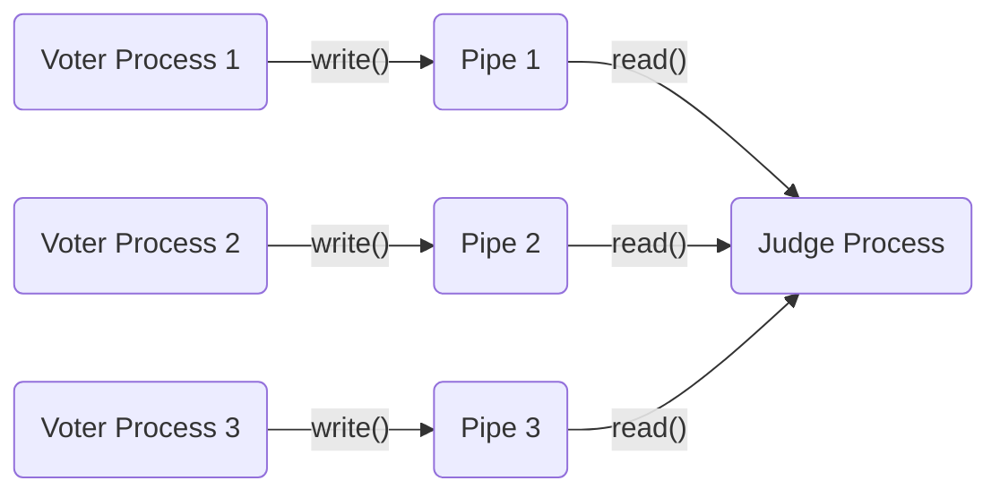
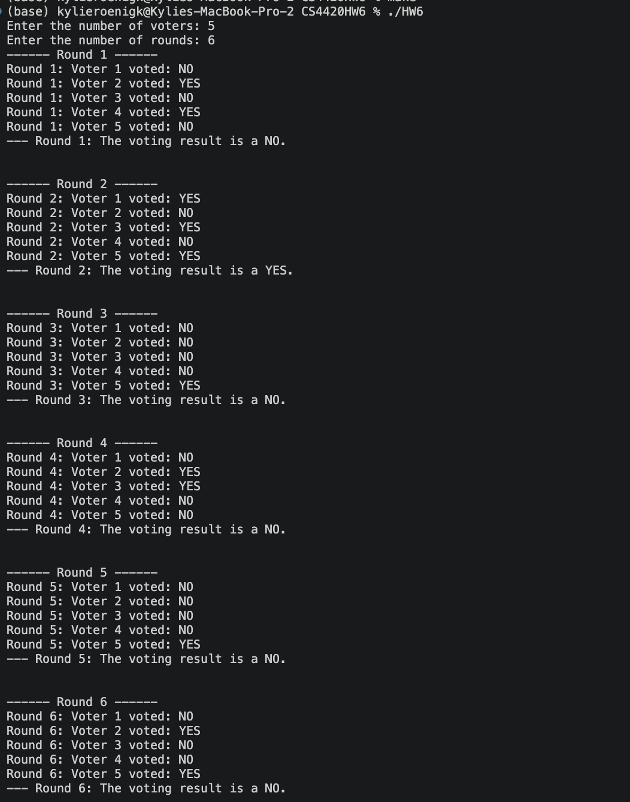
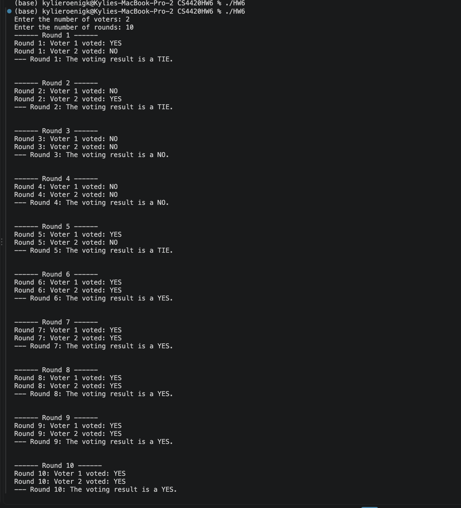
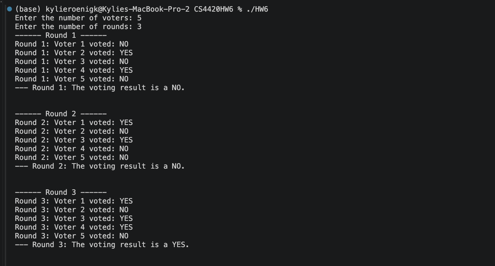
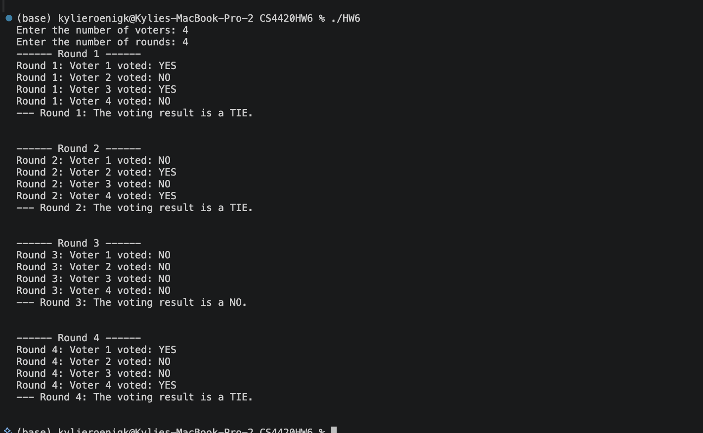

# Homework 6

This is the code for Homework 6 of CS4420, which implements a voting system using processes and pipes in C. The program consists of a judge process that collects votes from multiple voter processes and determines the majority vote.

## Project structure

```text
HW6.c       Main program and calculation placeholder
Makefile    Build and clean commands
HW6         Generated executable
```

## Build and run

You need a C compiler and Make installed. Run these commands from this folder:

```sh
make             # Compile to HW6 in this folder
./HW6            # Run the program
make clean       # Remove the executable
```

You can also run the executable directly with `./HW6`.

## How Processes interact with each other

The judge process creates a pipe for each voter process to communication. The pipe has two ends: pipes[i]\[0] is the read end, and pipes[i]\[1] is the write end. It also forks a child process for each voter. The judge process uses read() from the pipes to get each child processes' votes and declares the majority once all votes are received. The voters use write() to the pipes with their votes randomly each round.



## Screenshots of the program running








